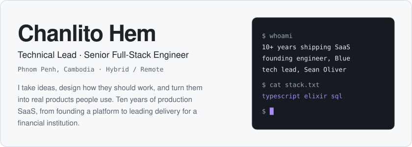
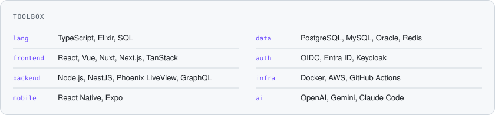
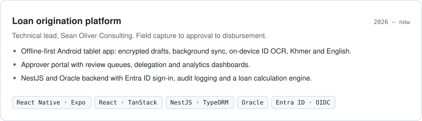
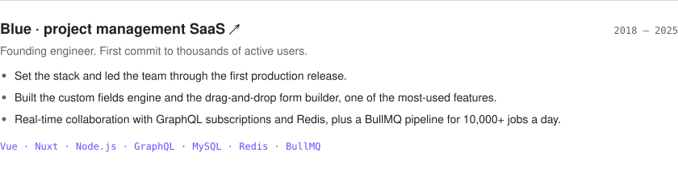
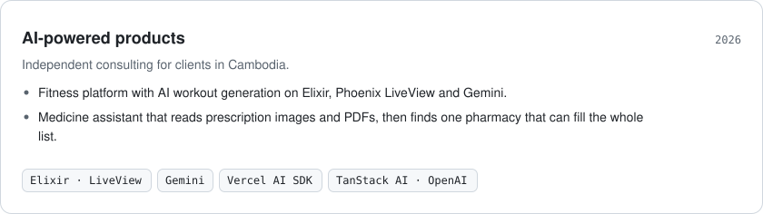
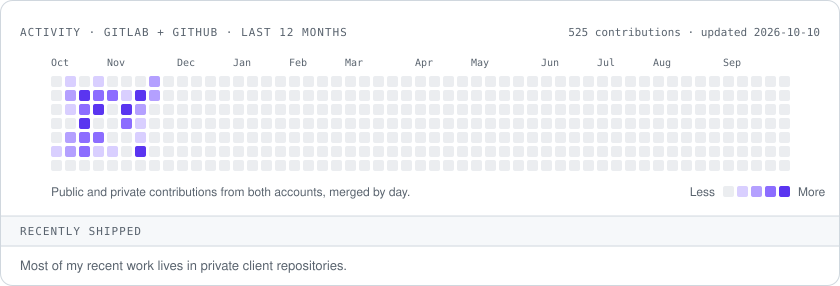

<!-- Generated by scripts/build.mjs from profile/content.mjs. Edit those files, not this one. -->

<picture><source media="(prefers-color-scheme: dark)" srcset="assets/header-dark.svg"></picture>

<a href="https://linkedin.com/in/chanlito"><picture><source media="(prefers-color-scheme: dark)" srcset="assets/btn-linkedin-dark.svg"></picture></a>
<a href="mailto:chanlitohem@gmail.com"><picture><source media="(prefers-color-scheme: dark)" srcset="assets/btn-email-dark.svg"></picture></a>

<picture><source media="(prefers-color-scheme: dark)" srcset="assets/toolbox-dark.svg"></picture>

### Selected work

<picture><source media="(prefers-color-scheme: dark)" srcset="assets/work-loan-dark.svg"></picture>

<a href="https://blue.cc/"><picture><source media="(prefers-color-scheme: dark)" srcset="assets/work-blue-dark.svg"></picture></a>

<picture><source media="(prefers-color-scheme: dark)" srcset="assets/work-ai-dark.svg"></picture>

### Now

Leading the loan origination platform at Sean Oliver Consulting, and hiring full-stack engineers to join the team.

<picture><source media="(prefers-color-scheme: dark)" srcset="assets/activity-dark.svg"></picture>

### Changelog

<picture><source media="(prefers-color-scheme: dark)" srcset="assets/changelog-dark.svg"></picture>

---

Speaks Spanish, Khmer and English. Off the clock: World of Warcraft and Path of Exile.&nbsp;&nbsp;
