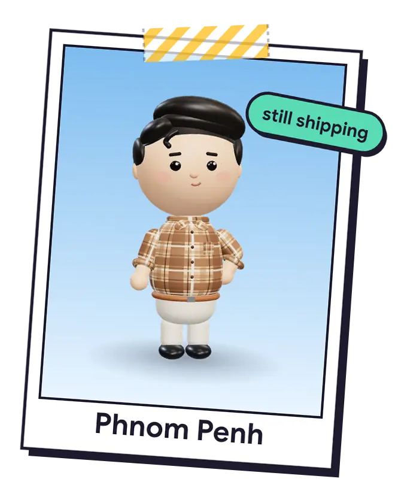

<a href="https://chanlito.dev"><picture><source media="(prefers-color-scheme: dark)" srcset="assets/hero-dark.svg"></picture></a><a href="https://chanlito.dev/about/"><picture><source media="(prefers-color-scheme: dark)" srcset="assets/polaroid-dark.webp"></picture></a>

<h3><picture><source media="(prefers-color-scheme: dark)" srcset="assets/h-now-dark.svg"></picture></h3>

- Leading the build of a **loan origination system** for a financial institution in Cambodia.
- Building **[chanlito.dev](https://chanlito.dev)** on holidays and weekends, and learning Astro with it.
- Open to talking about freelance and consulting work.

<h3><picture><source media="(prefers-color-scheme: dark)" srcset="assets/h-built-dark.svg"></picture></h3>

<a href="https://chanlito.dev/projects/#blue"><picture><source media="(prefers-color-scheme: dark)" srcset="assets/card-blue-dark.svg"></picture></a><a href="https://chanlito.dev/projects/#loan-system"><picture><source media="(prefers-color-scheme: dark)" srcset="assets/card-loan-system-dark.svg"></picture></a><a href="https://chanlito.dev/projects/#caracol"><picture><source media="(prefers-color-scheme: dark)" srcset="assets/card-caracol-dark.svg"></picture></a><a href="https://chanlito.dev/projects/#tesjor"><picture><source media="(prefers-color-scheme: dark)" srcset="assets/card-tesjor-dark.svg"></picture></a>

<h3><picture><source media="(prefers-color-scheme: dark)" srcset="assets/h-ink-dark.svg"></picture></h3>

<a href="https://chanlito.dev/articles/how-id-do-pull-request-review-today/"><picture><source media="(prefers-color-scheme: dark)" srcset="assets/article-0-dark.svg"></picture></a><a href="https://chanlito.dev/articles/green-tests-broken-app-why-our-agents-have-to-show-their-work/"><picture><source media="(prefers-color-scheme: dark)" srcset="assets/article-1-dark.svg"></picture></a><a href="https://chanlito.dev/articles/why-good-software-ideas-in-cambodia-stay-ideas/"><picture><source media="(prefers-color-scheme: dark)" srcset="assets/article-2-dark.svg"></picture></a>

<h3><picture><source media="(prefers-color-scheme: dark)" srcset="assets/h-hi-dark.svg"></picture></h3>

Got a product to build, a team that needs a technical lead, or just a question? Send me a note.

<a href="mailto:hi@chanlito.dev"><picture><source media="(prefers-color-scheme: dark)" srcset="assets/btn-email-dark.svg"></picture></a> <a href="https://www.linkedin.com/in/chanlito"><picture><source media="(prefers-color-scheme: dark)" srcset="assets/btn-linkedin-dark.svg"></picture></a> <a href="https://chanlito.dev"><picture><source media="(prefers-color-scheme: dark)" srcset="assets/btn-site-dark.svg"></picture></a>

<picture><source media="(prefers-color-scheme: dark)" srcset="assets/flag-km-dark.svg"></picture> <b>អានជាភាសាខ្មែរ</b>

### សួស្ដី ខ្ញុំឈ្មោះ Chanlito។

ខ្ញុំជាអ្នកដឹកនាំផ្នែកបច្ចេកទេសនៅភ្នំពេញ។ ខ្ញុំបង្កើតផលិតផល SaaS និងផលិតផលសម្រាប់សហគ្រាស ហើយខ្ញុំសរសេរអំពី TypeScript កម្មវិធីដែលដំណើរការដោយគ្មានអ៊ីនធឺណិត និងការបង្កើតកម្មវិធីនៅកម្ពុជា។

**ឥឡូវនេះ**

- ខ្ញុំកំពុងដឹកនាំការបង្កើត**ប្រព័ន្ធផ្ដល់ប្រាក់កម្ចី**សម្រាប់គ្រឹះស្ថានហិរញ្ញវត្ថុមួយនៅកម្ពុជា។
- បង្កើតគេហទំព័រ **[chanlito.dev](https://chanlito.dev/km/)** នៅថ្ងៃឈប់សម្រាក និងចុងសប្ដាហ៍។
- ពិភាក្សាអំពីការងារ freelance និងការប្រឹក្សា។

**គម្រោង**

- **[Blue](https://chanlito.dev/km/projects/#blue)** (2018 – 2025): វេទិកា​គ្រប់គ្រង​ដំណើរការ​ការងារ ដែល​ក្រុម​ការងារ​រាប់ពាន់​ប្រើប្រាស់។
- **[ប្រព័ន្ធ​ដំណើរការ​ស្នើសុំ​កម្ចី](https://chanlito.dev/km/projects/#loan-system)** (2026 – បច្ចុប្បន្ន): ជំនួស​ដំណើរការ​កម្ចី​លើ​ក្រដាស នៅ​ស្ថាប័ន​ហិរញ្ញវត្ថុ​មួយ​នៅ​កម្ពុជា។
- **[Caracol Sports Club](https://chanlito.dev/km/projects/#caracol)** (2026): គេហទំព័រ និង​កម្មវិធី​ហាត់ប្រាណ សម្រាប់​កន្លែង​ហាត់ប្រាណ​មួយ​នៅ​ភ្នំពេញ។
- **[Tesjor](https://chanlito.dev/km/projects/#tesjor)** (2016 – 2017): កម្មវិធី​កុម្ម៉ង់​អាហារ ដោយ​មិន​ប្រើ​សាច់ប្រាក់ ដំបូង​គេ​នៅ​កម្ពុជា។

**តោះបង្កើតអ្វីមួយជាមួយគ្នា**

មានផលិតផលចង់បង្កើត ក្រុមដែលត្រូវការអ្នកដឹកនាំផ្នែកបច្ចេកទេស ឬគ្រាន់តែមានសំណួរ? ផ្ញើសារមកខ្ញុំ។ [hi@chanlito.dev](mailto:hi@chanlito.dev)

<picture><source media="(prefers-color-scheme: dark)" srcset="assets/flag-es-dark.svg"></picture> <b>Léelo en español</b>

### Hola, soy Chanlito.

Soy líder técnico en Phnom Penh. Creo productos SaaS y empresariales, y escribo sobre TypeScript, apps offline-first y cómo crear software en Camboya.

**Ahora**

- Dirijo la construcción de un **sistema de originación de préstamos** para una institución financiera en Camboya.
- Construyo **[chanlito.dev](https://chanlito.dev/es/)** en vacaciones y fines de semana, y aprendo Astro con él.
- Abierto a hablar de trabajo freelance y consultoría.

**Cosas que hice**

- **[Blue](https://chanlito.dev/es/projects/#blue)** (2018 – 2025): Una plataforma de gestión de procesos con la que miles de equipos organizan su trabajo.
- **[Sistema de originación de préstamos](https://chanlito.dev/es/projects/#loan-system)** (2026 – hoy): Sustituye un proceso de préstamos en papel en una institución financiera de Camboya.
- **[Caracol Sports Club](https://chanlito.dev/es/projects/#caracol)** (2026): La web y la app de entrenamiento de un gimnasio con piscina en Phnom Penh.
- **[Tesjor](https://chanlito.dev/es/projects/#tesjor)** (2016 – 2017): La primera app de pedidos de comida sin efectivo de Camboya.

**Construyamos algo**

¿Tienes un producto por crear, un equipo que necesita un líder técnico o solo una pregunta? Escríbeme. [hi@chanlito.dev](mailto:hi@chanlito.dev)

