<a href="README.md"><picture><source media="(prefers-color-scheme: dark)" srcset="assets/tab-en-dark.svg"></picture></a><a href="README.km.md"><picture><source media="(prefers-color-scheme: dark)" srcset="assets/tab-km-dark.svg"></picture></a><a href="README.es.md"><picture><source media="(prefers-color-scheme: dark)" srcset="assets/tab-es-on-dark.svg"></picture></a>

<a href="https://chanlito.dev/es/"><picture><source media="(prefers-color-scheme: dark)" srcset="assets/sheet-es-dark.svg"></picture></a>

<a href="mailto:hi@chanlito.dev"><picture><source media="(prefers-color-scheme: dark)" srcset="assets/btn-email-dark.svg"></picture></a> <a href="https://www.linkedin.com/in/chanlito"><picture><source media="(prefers-color-scheme: dark)" srcset="assets/btn-linkedin-dark.svg"></picture></a> <a href="https://chanlito.dev"><picture><source media="(prefers-color-scheme: dark)" srcset="assets/btn-site-dark.svg"></picture></a>

