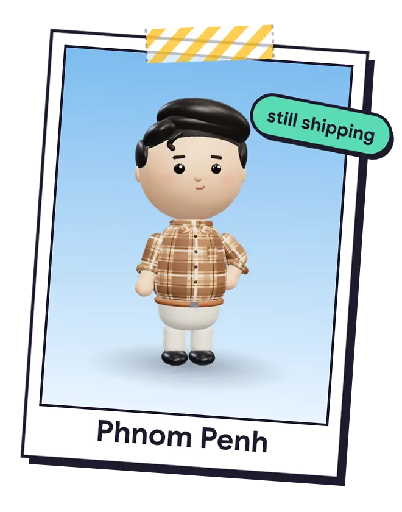

<a href="https://chanlito.dev/about/"><picture><source media="(prefers-color-scheme: dark)" srcset="assets/polaroid-en-dark.webp"></picture></a> <a href="https://chanlito.dev"><picture><source media="(prefers-color-scheme: dark)" srcset="assets/name-tag-dark.svg"></picture></a>

<a href="https://chanlito.dev/now/"><picture><source media="(prefers-color-scheme: dark)" srcset="assets/sticky-now-dark.svg"></picture></a> <a href="https://chanlito.dev/uses/"><picture><source media="(prefers-color-scheme: dark)" srcset="assets/kit-dark.svg"></picture></a>

<a href="https://chanlito.dev/articles/how-id-do-pull-request-review-today/"><picture><source media="(prefers-color-scheme: dark)" srcset="assets/article-0-dark.svg"></picture></a> <a href="https://chanlito.dev/articles/green-tests-broken-app-why-our-agents-have-to-show-their-work/"><picture><source media="(prefers-color-scheme: dark)" srcset="assets/article-1-dark.svg"></picture></a> <a href="https://chanlito.dev/articles/why-good-software-ideas-in-cambodia-stay-ideas/"><picture><source media="(prefers-color-scheme: dark)" srcset="assets/article-2-dark.svg"></picture></a>

<a href="https://chanlito.dev/projects/#blue"><picture><source media="(prefers-color-scheme: dark)" srcset="assets/card-blue-dark.svg"></picture></a> <a href="https://chanlito.dev/projects/#loan-system"><picture><source media="(prefers-color-scheme: dark)" srcset="assets/card-loan-system-dark.svg"></picture></a> <a href="https://chanlito.dev/projects/#caracol"><picture><source media="(prefers-color-scheme: dark)" srcset="assets/card-caracol-dark.svg"></picture></a> <a href="https://chanlito.dev/projects/#tesjor"><picture><source media="(prefers-color-scheme: dark)" srcset="assets/card-tesjor-dark.svg"></picture></a>

<a href="https://chanlito.dev"><picture><source media="(prefers-color-scheme: dark)" srcset="assets/stamp-en-dark.svg"></picture></a><a href="https://chanlito.dev/km/"><picture><source media="(prefers-color-scheme: dark)" srcset="assets/stamp-km-dark.svg"></picture></a><a href="https://chanlito.dev/es/"><picture><source media="(prefers-color-scheme: dark)" srcset="assets/stamp-es-dark.svg"></picture></a> <a href="mailto:hi@chanlito.dev"><picture><source media="(prefers-color-scheme: dark)" srcset="assets/envelope-dark.svg"></picture></a>

